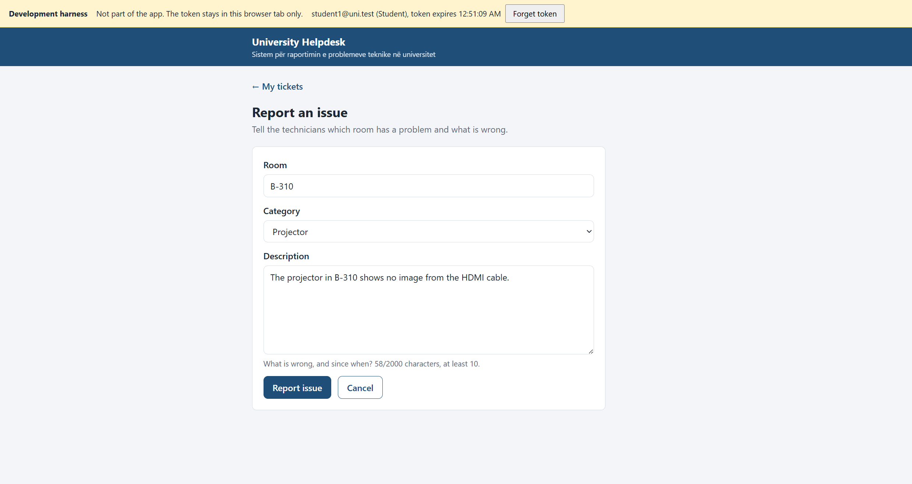
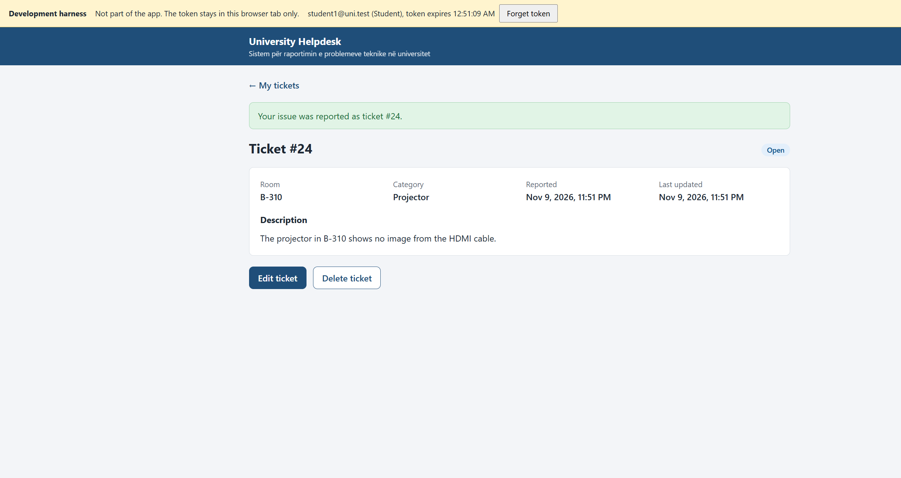
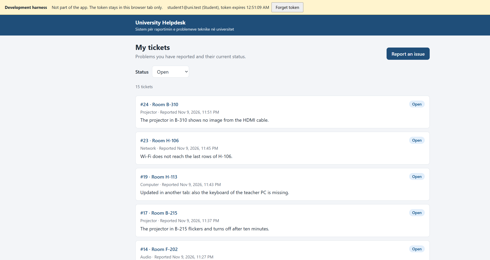
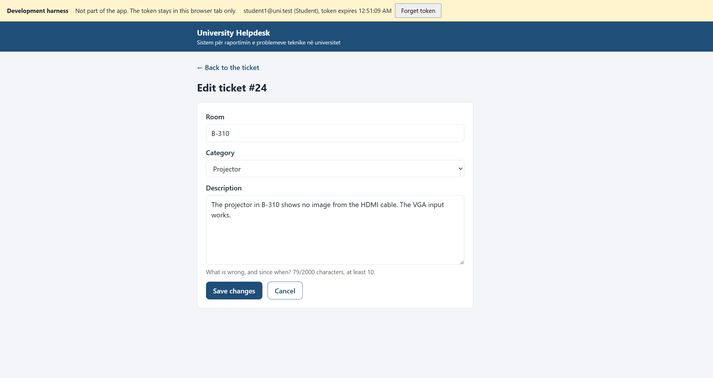
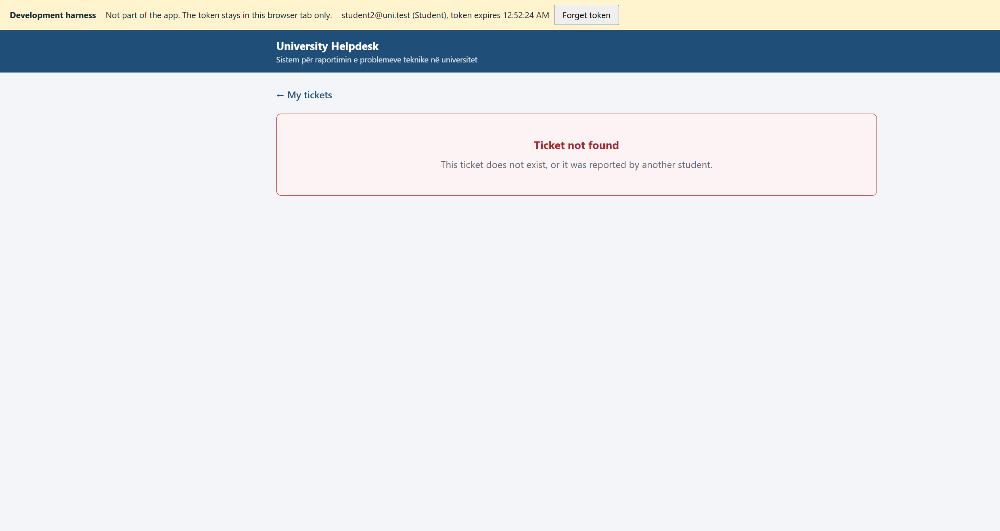
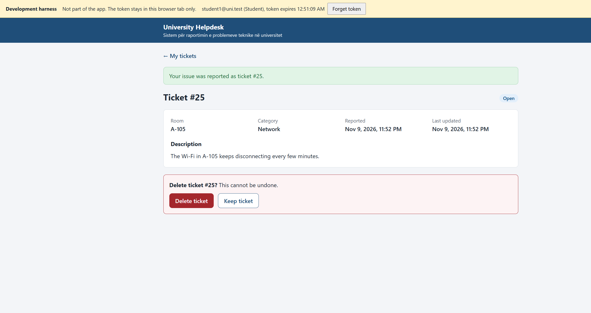
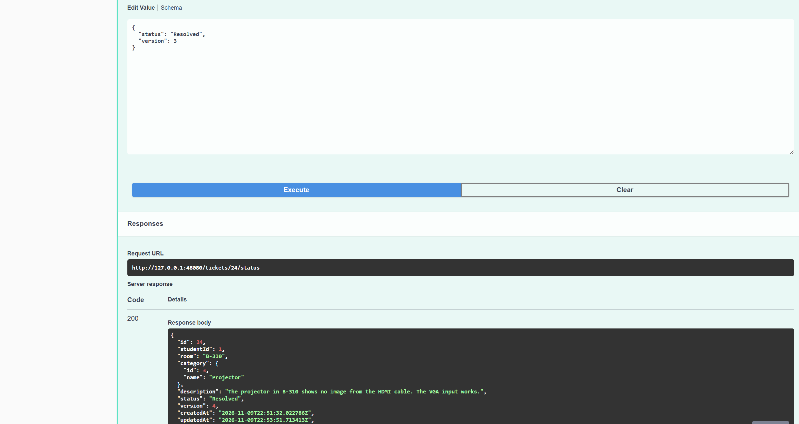
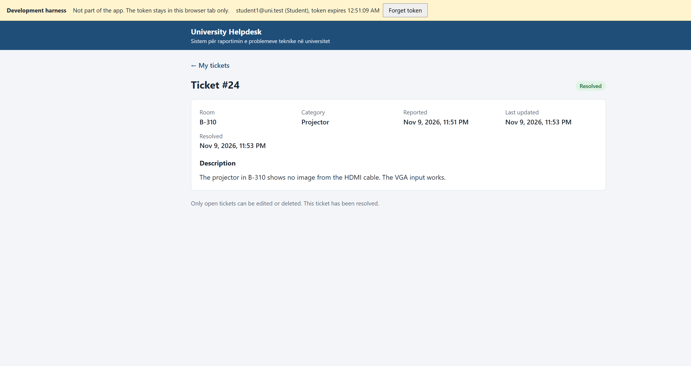

# Demo runbook

A step-by-step script for the live demonstration at the defense (section 12 of
the course requirements): a student reports a problem in Swagger, a technician
resolves it, the student sees the new status, and the resolution email arrives
in Mailpit. Along the way it shows one access-control check and the matching
rows in PostgreSQL. The slides are in [`presentation.md`](presentation.md).

The demo uses the Docker Compose system and takes about 8 minutes. The
[rehearsal record](#rehearsal-record) at the end lists what was actually run
before the defense and what was not.

> **React frontend.** React sign-in, the student screens, and the technician
> queue with status actions are built; see
> [Student screens in the browser](#student-screens-in-the-browser). The
> full React walkthrough will be added once the frontend is served by Docker
> Compose; until then, the main demo below uses Swagger, and so does the
> technician part of the student walkthrough.

## Before the defense

Do these the day before, on the computer that will be used for the demo:

1. Start the system and check that every service is healthy (see "Start the
   system" below). `docker compose up -d --build` needs internet access the
   first time: the .NET base images are not stored on the demo laptop. If the
   images `university-helpdesk-api:local` and `university-helpdesk-worker:local`
   already exist and the code has not changed since they were built, use
   `docker compose up -d --no-build --wait` instead, which works offline.
2. Run the whole demo once and note the ticket number it creates.
3. Prepare two browser windows: one normal and one private (incognito). Swagger
   keeps one token per window, so the student uses one window and the
   technician the other, and nobody has to log out in the middle of the demo.
4. Have the demo passwords ready from `.env` (`DEMO_STUDENT1_PASSWORD`,
   `DEMO_STUDENT2_PASSWORD`, `DEMO_TECHNICIAN1_PASSWORD`) without opening `.env`
   on the projected screen. They are local demo passwords, but `.env` also
   holds the database, RabbitMQ, and JWT secrets.
5. Decide who presents which part. Each member explains their own confirmed
   contribution (slide "Individual contributions").

On a Windows computer where Docker runs inside WSL, keep a WSL terminal open
for the whole defense. When WSL has no open session it shuts down after a
while, and the containers stop with it. PostgreSQL, RabbitMQ, Redis, and
Mailpit do not restart on their own afterwards (a known finding in
[`verification-results.md`](verification-results.md#follow-up-findings)); run
`docker compose up -d --no-build --wait` again if that happens.

## Start the system

In a terminal in the repository folder (in WSL, `cd` to the folder under
`/mnt/c/...`):

```bash
docker compose up -d --no-build --wait
docker compose ps
```

Expected: `db-init` has exited with `0`, and `api` (two replicas), `gateway`,
`worker`, `postgres`, `rabbitmq`, `redis`, and `mailpit` are `healthy`.

Open these tabs:

| Tab | URL |
| --- | --- |
| Swagger, student (normal window) | `http://127.0.0.1:58080/swagger` |
| Swagger, technician (private window) | `http://127.0.0.1:58080/swagger` |
| Mailpit | `http://127.0.0.1:58025` |

Use `127.0.0.1` rather than `localhost`: on the demo laptop each new connection
to `localhost` waited about 2 seconds (see
[`benchmark-results.md`](benchmark-results.md)).

## The demo

Each step lists what to do, what the audience should see, and what to say. The
ticket number, timestamps, and versions in the examples come from the
rehearsal; yours will differ.

### 1. The student signs in (student window)

In **Auth → `POST /auth/login`**, select **Try it out** and send:

```json
{ "email": "student1@uni.test", "password": "<DEMO_STUDENT1_PASSWORD>" }
```

Expected: `200` with `accessToken`, `tokenType: "Bearer"`, `expiresIn: 3600`,
and `user.role: "Student"`. Copy the `accessToken`, select **Authorize** at the
top of the page, paste it, and close the dialog.

Say: passwords are stored as hashes; the token is a signed JWT that carries
the user's ID and role and expires after an hour.

### 2. The student reports a problem

Optional: **`GET /categories`** returns the six categories; Projector has
ID `3`.

In **`POST /tickets`**, send:

```json
{ "room": "B-204", "categoryId": 3, "description": "The projector shows no image from the HDMI cable." }
```

Expected: `201 Created` with a `Location` header such as `/tickets/10004`,
`status: "Open"`, and `version: 1`. Note the ticket `id`.

Say: the server sets the owner from the token, the status, and the version;
a client cannot send them.

### 3. Access-control check: the student tries to resolve the ticket

Still as the student, in **`PATCH /tickets/{id}/status`**, enter the ticket ID
and send:

```json
{ "status": "Resolved", "version": 1 }
```

Expected: `403 Forbidden`. Only technicians may change the status.

Say: roles are enforced on the server by authorization policies, not by
hiding buttons in a client. The other rule to mention: another student gets
`404` for this ticket, so its existence is not revealed (test case TC-08).

### 4. The technician moves the ticket forward (technician window)

Sign in as in step 1 with `technician1@uni.test` and authorize.

1. **`GET /tickets`** with `status` = `Open`: the new ticket is listed.
2. **`PATCH /tickets/{id}/status`** with
   `{ "status": "InProgress", "version": 1 }`: `200`, status `InProgress`,
   version `2`.
3. **`PATCH /tickets/{id}/status`** with
   `{ "status": "Resolved", "version": 2 }`: `200`, status `Resolved`,
   version `3`, and `resolvedAt` is set.

Optional, to show concurrency control: send `{ "status": "Resolved", "version": 1 }`
before the last step. Expected: `409 Conflict`, because the ticket has changed
since version 1.

Say: each change is one conditional `UPDATE` that checks the current status and
version, so two technicians cannot both apply a change. Resolving the ticket
also saves a notification event in the same database transaction.

### 5. The student sees the update (student window)

**`GET /tickets/{id}`**: `200`, status `Resolved`, version `3`, and
`resolvedAt` is set.

### 6. The email arrives in Mailpit

Switch to the Mailpit tab (it updates by itself). Expected: an email from
University Helpdesk to `student1@uni.test` with the subject
"Your helpdesk ticket #&lt;id&gt; has been resolved", containing the room, the
category, the resolution time, and the student's description. In the
rehearsal it arrived within 0.6 to 0.9 seconds of resolving.

Say: the API never sends email itself. It published the event to RabbitMQ, and
the separate Notification Worker sent the email. If the worker or the mail
server is down, the event waits and the email is sent later (recovery checks,
TC-33).

### 7. The same data in PostgreSQL

In the terminal, replace `10004` with your ticket ID:

```bash
docker compose exec postgres psql -U helpdesk -d helpdesk -c 'SELECT t."Id", u."Email", c."Name" AS "Category", t."Room", t."Status", t."Version", t."ResolvedAt" FROM "Tickets" t JOIN "Users" u ON u."Id" = t."StudentId" JOIN "Categories" c ON c."Id" = t."CategoryId" WHERE t."Id" = 10004;'
docker compose exec postgres psql -U helpdesk -d helpdesk -c 'SELECT "TicketId", "EventType", "RecipientEmail", "PublishedAt" FROM "PendingNotifications" WHERE "TicketId" = 10004;'
```

These commands use the database user and name from `.env.example`; if `.env`
changes `POSTGRES_USER` or `POSTGRES_DB`, use those values. Rehearsal output:

```text
  Id   |       Email       | Category  | Room  |  Status  | Version |          ResolvedAt
-------+-------------------+-----------+-------+----------+---------+------------------------------
 10004 | student1@uni.test | Projector | B-204 | Resolved |       3 | 2026-11-09 21:02:15.14958+00

 TicketId |   EventType    |  RecipientEmail   |          PublishedAt
----------+----------------+-------------------+-------------------------------
    10004 | TicketResolved | student1@uni.test | 2026-11-09 21:02:15.765031+00
```

Say: the row the API returned is the row in the database, with the student and
category joined through foreign keys. The `PendingNotifications` row is the
transactional outbox: it was written in the same transaction as the status
change, and `PublishedAt` was set once RabbitMQ confirmed the event.

### If something goes wrong

| Problem | What to do |
| ------- | ---------- |
| `401` in Swagger | The token is missing or expired: sign in again and select **Authorize**. Check that you pasted only the token, without `Bearer`. |
| `409` on a status change | The version is stale: `GET /tickets/{id}`, then repeat with the current `version`. |
| A container is not healthy, or the API reports unhealthy after a break | `docker compose up -d --no-build --wait`. |
| No email after a few seconds | `docker compose logs worker --tail 20`. The event is not lost: it waits in the outbox or the queue. |
| Swagger does not load at all | Run the same flow with the Postman collection: `npx newman run tests/postman/UniversityHelpdesk.postman_collection.json -e tests/postman/local.postman_environment.json` (see the README). |

## Student screens in the browser

The same story with the React student screens instead of the student's
Swagger window. The technician part still uses Swagger; technicians can also
use **Start work** and **Resolve ticket** on the React ticket page. Docker
Compose serves the app from the gateway, so nothing else needs to run; the
routes, the session, and the API client are described in
[`frontend-handoff.md`](frontend-handoff.md).

**Setup.**

1. Start the system as above.
2. In the student browser window, open `http://localhost:58080` and sign in as
   `student1@uni.test`. The header shows "Demo Student One, Student" and
   **Sign out**.
3. In the private window, open `http://localhost:58080` and sign in as
   `student2@uni.test`. Each tab keeps its own session.
4. The technician signs in to Swagger in a third window, or in the private
   window after the student 2 check.

**S1. Report an issue (student 1).** Select **Report an issue**, enter room,
category, and description, and select **Report issue**. Expected: the new
ticket opens with "Your issue was reported as ticket #&lt;id&gt;.", status
**Open**, and **Edit ticket** and **Delete ticket** buttons. Leaving a field
empty shows the error next to it, and the form keeps what was typed.




**S2. Find it in the list.** Select **My tickets**. Expected: the ticket is at
the top (newest first). Choose **Open** under **Status**: the URL becomes
`/student/tickets?status=Open`, the count updates, and the ticket is still
first. With more than 10 tickets, **Next** shows the following page.



**S3. Edit it while it is open.** Open the ticket, select **Edit ticket**,
change the description, and select **Save changes**. Expected: "Your changes
were saved." and the new description. The form sends the ticket's version; if
someone changed the ticket in the meantime, the student sees both versions
and chooses whether to reapply their changes.



**S4. Ownership (student 2).** In student 2's tab, open
`http://localhost:58080/student/tickets/<id>` for student 1's ticket. Expected: "Ticket not found.
This ticket does not exist, or it was reported by another student." The API
answers `404`, so student 2 cannot tell whether the ticket exists. Student 2's
list does not include it.



**S5. Delete a separate open ticket (student 1).** Report a second issue, then
on its page select **Delete ticket**. Expected: a confirmation, "Delete ticket
#&lt;id&gt;? This cannot be undone.", with **Delete ticket** and **Keep ticket**.
Confirm: the list opens with "Ticket #&lt;id&gt; was deleted.", and the ticket is
gone.



**S6. The technician resolves the first ticket (Swagger).** As in demo
step 4, send `PATCH /tickets/{id}/status` with `InProgress` and then
`Resolved`, each with the current version. Before taking a screenshot, close
the **Authorize** dialog and keep the curl command off screen: it contains the
token.



**S7. The student sees Resolved.** Back in student 1's tab, refresh the
ticket page. Expected: status **Resolved**, a **Resolved** time, no **Edit** or
**Delete**, and "Only open tickets can be edited or deleted. This ticket has
been resolved." The resolution email is in Mailpit as in demo step 6.



## Live-change exercise: filter tickets by room

Section 12 says the teacher may ask for a small change during the defense,
such as a new field, filter, or validation. Practice this one until it takes
under 10 minutes. Make the change on a separate branch, not on `main`.

**Task.** `GET /tickets?room=B-204` returns only tickets in that room. Students
still see only their own tickets. The value is trimmed, matched exactly, and at
most 50 characters, like a ticket's room; a longer value returns `400`.

**1. Add the query parameter** in
`backend/UniversityHelpdesk.Api/Tickets/TicketContracts.cs`, in
`ListTicketsQuery` after `Status`:

```csharp
    [MaxLength(50)]
    public string? Room { get; set; }
```

**2. Apply the filter** in `backend/UniversityHelpdesk.Api/Tickets/TicketService.cs`,
in `ListAsync` after the status filter:

```csharp
        if (!string.IsNullOrWhiteSpace(query.Room))
        {
            var room = query.Room.Trim();
            tickets = tickets.Where(ticket => ticket.Room == room);
        }
```

The filter is added to `Visible(...)`, which already limits a student to their
own tickets, so the ownership rule needs no change. EF Core sends the room as
a query parameter, not as part of the SQL text.

**3. Add tests.** In `tests/UniversityHelpdesk.Api.Tests/TicketEndpointTests.cs`,
add a case to `ListTickets_WithInvalidQuery_Returns400` (no database needed):

```csharp
    [InlineData("?room=AAAAAAAAAAAAAAAAAAAAAAAAAAAAAAAAAAAAAAAAAAAAAAAAAAA", "room")]
```

In `tests/UniversityHelpdesk.Api.Tests/Integration/TicketCrudIntegrationTests.cs`:

```csharp
    [IntegrationFact]
    public async Task RoomFilter_ReturnsOnlyTicketsInThatRoom()
    {
        var owner = await fixture.Database.CreateAccountAsync("rooms", Domain.UserRole.Student);
        var student = await fixture.ClientForAsync(owner);
        var inRoom = (await student.CreateTicketAsync(room: "R-101")).Id();
        await student.CreateTicketAsync(room: "R-102");

        var body = await (await student.GetAsync("/tickets?room=%20R-101%20")).ReadJsonAsync();

        Assert.Equal(1, body.GetProperty("totalCount").GetInt32());
        Assert.Equal(new[] { inRoom }, body.GetProperty("items").EnumerateArray().Select(item => item.Id()));
    }
```

**4. Run the tests.**

```powershell
dotnet test tests/UniversityHelpdesk.Api.Tests --filter "FullyQualifiedName~ListTickets_WithInvalidQuery"
```

With `HELPDESK_TEST_DATABASE` set as in the README, add
`|FullyQualifiedName~RoomFilter` to the filter to run the database test too.

**5. Show it in Swagger.** Rebuilding the Compose images needs internet access
(see "Before the defense"). Without it, leave the Compose stack running and
start only the changed API from source, as in the README ("Run the API and
worker from source", steps 2 and 6, with the connection string and user
secrets). Do not start a second worker. Open `http://localhost:5276/swagger`:
`GET /tickets` now has a `room` parameter. Stop `dotnet run` afterwards.

Other changes worth practicing in the same way: a `category` filter on
`GET /tickets` (same pattern), or a validation rule such as rejecting a room
that contains no letters or digits (an attribute on `CreateTicketRequest`
and `UpdateTicketRequest`, plus cases in the `400` tests).

## After the demo

```bash
docker compose stop
```

This keeps the data. The demo tickets stay in the database as ordinary
tickets; `docker compose down -v` deletes all data and is not needed.

## Rehearsal record

Rehearsed on 9 November 2026 on commit `7c0b1f8`, on the laptop described in
[`verification-results.md`](verification-results.md), against the Compose
stack started with `docker compose up -d --no-build --wait` from images built
on 8 November after the last change to `backend/` (rebuilding failed: WSL
could not resolve `mcr.microsoft.com` at the time).

| Step | What ran | Result |
| ---- | -------- | ------ |
| Start | `docker compose up -d --no-build --wait` | All 8 services healthy, `db-init` exited `0`, in 35 s |
| Swagger and Mailpit pages | Opened `http://127.0.0.1:58080/swagger` and `http://127.0.0.1:58025` in a browser | Swagger listed every endpoint and the **Authorize** button; Mailpit showed the resolution email |
| Steps 1 to 6 | The same requests as above, sent by a script over HTTP to the gateway, twice | Both runs: login `200`, ticket `201` (`10003`, then `10004`), student status change `403`, student 2 reading the ticket `404`, `InProgress` `200` (version 2), stale version `409`, `Resolved` `200` (version 3), student reads `Resolved`; the email reached `student1@uni.test` in Mailpit 0.9 s and 0.6 s after resolving. Each run took under 4 s |
| Step 7 | Both `psql` commands, as written above | Ticket row `Resolved`, version 3, room `B-204`, owner `student1@uni.test`; one `TicketResolved` row with `PublishedAt` set 0.6 s after `ResolvedAt` |
| Live-change exercise | Steps 1 to 4 in a temporary copy of the repository, discarded afterwards | Built in 33 s with 0 errors. Against a local `helpdesk_test` database, 13 selected tests passed, including the two new ones; the whole ordinary suite passed (API 87 passed and 18 skipped, worker 14 passed) |
| Live change in Swagger | The changed API run from source on `http://localhost:5276`, next to the Compose stack | `GET /tickets?room=B-204` as student 1 returned 2 of their 3 tickets, both in `B-204`; a 51-character room returned `400`; Swagger listed the `room` parameter with a maximum length of 50 |

**Student screens in the browser.** Rehearsed on 9 November 2026 on commit
`ec709fe` plus the wording fix for resolved tickets in the same change, with
`npm run dev` forwarding to a separate Compose stack started by
`scripts/verify-compose.sh` from a fresh `.env` and new volumes (gateway on
port `48080`, Mailpit on `48025`). The student screens ran in the development
harness (since replaced by React sign-in, which is why the screenshots show
its yellow banner instead of the header) and the technician used Swagger;
React sign-in and the technician screens were not built yet. Tokens came from
`POST /auth/login` and went straight into the browser tab, without being
shown, copied into a file, or logged. Student 1 already had 19 tickets from
earlier checks.

| Step | Result |
| ---- | ------ |
| S1 Report | Ticket `#24` (B-310, Projector) created, opened with "Your issue was reported as ticket #24.", status Open, version 1 |
| S2 List | 20 tickets, `#24` first; with **Open**, 15 tickets and `#24` first |
| S3 Edit | Description changed; "Your changes were saved."; the API returned version 2 with the new text |
| S4 Ownership | Student 2 got "Ticket not found" for `#24` on both the detail and edit routes; their list showed only `#16` and `#15` |
| S5 Delete | Ticket `#25` (A-105, Network) reported, confirmation shown, deleted; list showed "Ticket #25 was deleted." and the API returned `404` for it |
| S6 Swagger | `InProgress` with version 2: `200`, version 3; `Resolved` with version 3: `200`, version 4, `resolvedAt` set |
| S7 Refresh | `#24` showed Resolved with the resolution time and no edit or delete actions. The email "Your helpdesk ticket #24 has been resolved" reached `student1@uni.test` in Mailpit 0.5 s after resolving |

The rehearsal found one wording problem: a resolved ticket said "This ticket
is being handled." It now says "This ticket has been resolved.", and an
in-progress ticket says "A technician is working on this ticket."

**Not rehearsed:**

- The whole student walkthrough with React sign-in instead of the harness.
  Sign-in, the role guards, session expiry, and sign-out were checked on
  their own against the same kind of stack; the full run waits for the
  frontend to be served by Docker Compose.
- The technician side in React as part of a full run. The ticket list,
  details, both status changes, and a stale update from a second technician
  session were checked on their own against the same kind of stack.
- The clicks in Swagger with a real login, **Authorize**, and two browser
  windows. The requests were the same, but they were sent by a script so that
  the passwords and tokens never appeared on screen or in any log. The team
  should click through the demo once before the defense.
- Rebuilding the images with the live change (`docker compose up --build`),
  because WSL had no DNS at the time.
- Timing a full presentation with speakers; the 8 minutes above is an
  estimate.
