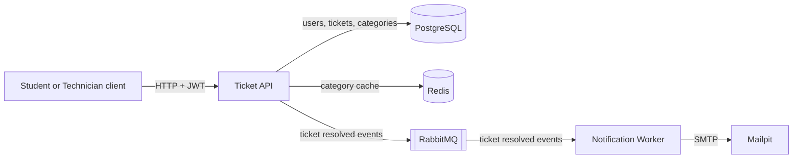
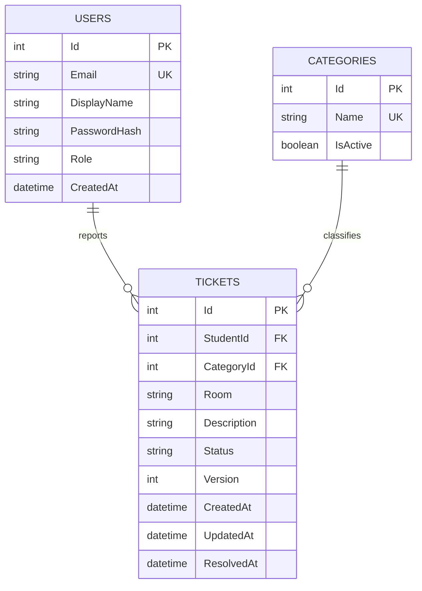

# Design

**University Helpdesk API** — *Sistem për raportimin e problemeve teknike në universitet*

This document describes the architecture as implemented; parts that are still
planned are marked as such. The requirements are in
[`requirements.md`](requirements.md) and the HTTP contract is in
[`api-contract.md`](api-contract.md).

## Services

The system has two separately deployable components:

- **Ticket API** — the HTTP API used by students and technicians. It stores
  users, categories, and tickets in PostgreSQL and caches the category list in
  Redis.
- **Notification Worker** — a background service that receives
  ticket-resolved events from RabbitMQ and sends confirmation emails. During
  local development, emails go to Mailpit, a test SMTP server with a web inbox.

A web frontend for students and technicians is planned but not built yet.
Until it exists, clients are the Swagger UI, the Postman collection, or any
HTTP client.



The API and the worker share no in-process state. They communicate only through
RabbitMQ, so either one can be restarted, scaled, or deployed without the other.

## Architecture choices

**Two separately deployed services.** Sending email is slow and depends on an
outside SMTP server, while the ticket requests must stay fast and available.
Running email delivery in its own Notification Worker means a slow or failed
mail server never blocks or fails a technician's request, and a crash in one
service does not stop the other. The two also scale differently: Compose and
Kubernetes run two API replicas behind a load balancer but one worker. The
worker has no HTTP endpoint and no database access; it only needs RabbitMQ and
SMTP, so it has its own small set of settings and secrets.

The Ticket API itself is one service with three internal layers rather than
several smaller services. Users, categories, and tickets are read and changed
together in the same requests and transactions; splitting them would turn
those into network calls and distributed transactions without a benefit at
this size. The course accepts a modular structure where it suits the project;
the boundary where independence pays off, notification delivery, is a separate
service.

**What RabbitMQ provides.** The API publishes a `TicketResolved` event to the
`helpdesk.events` exchange, and the durable `helpdesk.ticket-resolved` queue
keeps it until the worker takes it, even if the worker is stopped (recovery
check "Stopped worker"). The API marks an event as published only after the
broker confirms it, and the worker acknowledges a message only after the SMTP
server accepts the email, so neither side loses an event when the other
fails. Messages that still fail after the retries go to the
`helpdesk.ticket-resolved.failed` queue for inspection instead of being
dropped. Neither service needs to know where the other runs.

**Why PostgreSQL.** The data is relational and its rules map directly onto
database constraints:

- Foreign keys from tickets to their student and category, and from pending
  notifications to their ticket, all with `RESTRICT` on delete.
- Unique indexes on user emails, category names, and
  `(TicketId, EventType)`, so a ticket can never have two resolution events.
- Check constraints on roles, statuses, a positive `Version`, `ResolvedAt`
  being set exactly when the status is `Resolved`, and non-blank text fields.
- Transactions that save a status change and its outbox row together, and
  conditional `UPDATE` statements that check the version and status in one
  step (see "Consistency and resilience").
- `SELECT ... FOR UPDATE SKIP LOCKED` in the outbox publisher, so the two API
  replicas never claim the same pending event.

EF Core with the Npgsql provider supplies migrations and parameterized queries.
A document store would have left these relationships and atomic checks to
application code.

## Data model



| Table        | Notes                                                                                                                                                        |
| ------------ | ------------------------------------------------------------------------------------------------------------------------------------------------------------ |
| `Users`      | `Email` is unique and is the address used for resolution notifications. `Role` is `Student` or `Technician`.                                                 |
| `Categories` | `Name` is unique. Inactive categories stay in the table so existing tickets keep their category, but they are not listed or accepted for new tickets.         |
| `Tickets`    | `StudentId` references `Users.Id` and must belong to a `Student`. `CategoryId` references `Categories.Id`. `Status` is `Open`, `InProgress`, or `Resolved`. `ResolvedAt` is null until the ticket is resolved. `Version` supports concurrency checks. |

A student has zero or more tickets; each ticket has exactly one student owner
and one category. Deleting a user or category that has tickets is not
supported.

### Pending notifications

The `PendingNotifications` table acts as an outbox between the database and
RabbitMQ:

| Column           | Purpose                                                        |
| ---------------- | -------------------------------------------------------------- |
| `Id`             | Primary key. A stable event ID (UUID) generated by the API.    |
| `TicketId`       | The resolved ticket (foreign key to `Tickets.Id`).             |
| `RecipientEmail` | Copy of the student's email at the time of resolution.         |
| `EventType`      | `TicketResolved`.                                              |
| `Payload`        | JSON with the details needed to write the email.              |
| `CreatedAt`      | When the row was written.                                      |
| `PublishedAt`    | Null until the event has been published to RabbitMQ.           |
| `Attempts`       | Number of failed publish attempts. After 10, the event is left unpublished for inspection. |
| `NextAttemptAt`  | Earliest time of the next attempt after a failure; null means as soon as possible. The delay doubles after each failure, from 5 seconds up to 5 minutes. |

`(TicketId, EventType)` is unique, so a ticket can never have two resolution
events.

## Layers

The Ticket API is split into three layers. Each layer only calls the one below
it.

| Layer          | Code | Responsibility |
| -------------- | ---- | -------------- |
| HTTP           | `Controllers/`, `Authentication/`, `ErrorHandling/` | Routing, authentication, role policies, reading the user ID and role from the JWT, request validation, and mapping results to the status codes in the API contract. No business rules. |
| Business logic | `Tickets/TicketService`, `Categories/CategoryService`, `Domain/TicketWorkflow` | Ownership rules, the status workflow, and deciding when a notification is needed. Services return result objects (success, invalid field, not found, conflict), never HTTP responses. |
| Persistence    | `Persistence/`, `Categories/CategoryCache`, `Notifications/` | The EF Core context, entity configurations, and migrations; the Redis category cache; and the outbox publisher. |

`TicketWorkflow` holds the status rules as plain functions with no database
access, so they are unit tested on their own. `TicketService` is not independent
of the database: it applies ownership, state, and version checks inside single
conditional `UPDATE` and `DELETE` statements through EF Core, so that a check
and its change cannot be separated by a concurrent request. Its behavior is
therefore covered by the HTTP integration tests against PostgreSQL.

## Ticket workflow and permissions

```text
Open → InProgress → Resolved
```

- A new ticket is always `Open`.
- Only a `Technician` changes status, and only one step forward at a time.
  `Resolved` is final.
- A `Student` can edit (room, category, description) or delete **their own**
  ticket only while it is `Open`. Once work starts, the ticket is locked for the
  student.
- A `Student` sees only their own tickets. Another student's ticket is treated
  as not found, so its existence is not revealed.
- A `Technician` sees all tickets but cannot create, edit, or delete them.
- The server controls the owner (`StudentId`), `Status`, `Version`, and all
  timestamps. Clients cannot set them directly.

## Consistency and resilience

The implementation follows these rules. The README lists the tests and
recovery checks that exercise them.

**Concurrent edits and status changes.** Every ticket has a `Version` that the
server increments on each change. Clients send the version they last saw with
every edit or status change. The update is applied only if both the version
and the expected current status still match in the database; otherwise the
request fails with `409 Conflict` and nothing is changed. This prevents, for
example, a student editing a ticket at the same moment a technician moves it to
`InProgress`, or two technicians advancing the same ticket twice.

**Resolution and notification together.** When a ticket moves to `Resolved`,
the status change and a new `PendingNotifications` row are written in the same
database transaction. Either both are saved or neither is. A background
publisher then sends unpublished rows to RabbitMQ and marks them as published.
If RabbitMQ is down, rows wait and are retried, so no notification is lost and
the technician's request is not affected. A row is marked published only after
the broker confirms the message, so delivery is at least once: a crash after the
confirmation but before the database commit publishes the event again. The
worker must tolerate receiving the same event more than once; every message
carries the event ID as its message ID.

**Category cache fallback.** `GET /categories` first reads the category list
from Redis. On a cache miss, the API reads from PostgreSQL and stores the result
in Redis for 5 minutes. If Redis is unreachable, the API logs a warning and
serves the list from PostgreSQL, so the endpoint keeps working without the
cache. Connecting and each cache command are limited to 1 second, and while the
Redis client knows it is disconnected the cache is skipped immediately.

**Email delivery.** The Notification Worker acknowledges a message only after
the SMTP server accepts the email. A failed send is retried with increasing
delays; after the last attempt, the message is moved to the durable
`helpdesk.ticket-resolved.failed` queue with the failure reason, attempt count,
and time as headers. Delivery is at least once: if the worker crashes after the
SMTP server accepts the email but before the acknowledgement reaches RabbitMQ,
the message is redelivered and the student receives the email twice. The email's
`Message-ID` is derived from the event ID, so both copies carry the same ID.

## Deployment and operations

| Area               | Implementation                                                                                                                                             |
| ------------------ | ---------------------------------------------------------------------------------------------------------------------------------------------------------- |
| Local development  | Docker Compose starts the Ticket API, Notification Worker, PostgreSQL, Redis, RabbitMQ, and Mailpit with one command. A one-off `db-init` container applies migrations and creates the demo accounts; the two API replicas start only after it succeeds, so they never race to change the schema. An nginx gateway load-balances requests between the replicas and serves the React frontend, which its image builds from `frontend/` with the locked npm packages. Secrets come from environment variables in `.env`. |
| Kubernetes         | Kustomize manifests in `deploy/kubernetes/`, applied in three steps. First the stateful services: PostgreSQL and RabbitMQ as StatefulSets with persistent volumes, plus Redis and Mailpit. Then a `db-init` Job that applies migrations and creates the demo accounts. Last, the Ticket API as a Deployment with two replicas behind an internal Service, which load-balances requests between them, and the worker as its own Deployment. Secrets come from a local, git-ignored file that uses the same keys as `.env`. The Service is not exposed outside the cluster, so `/metrics` is available only to in-cluster monitoring. |
| CI                 | A GitHub Actions workflow (`.github/workflows/ci.yml`) runs on every push to `main` and every pull request. It builds the solution and runs the tests that need no services, then builds both images, deploys the Kubernetes manifests to a temporary kind cluster with random credentials, and runs a smoke test from login to the resolution email in Mailpit. Test results and deployment diagnostics are kept as artifacts. Nothing is deployed to a shared environment yet. |
| Transport security | `dotnet run` with the `https` launch profile serves HTTPS with the .NET development certificate and redirects HTTP to HTTPS. Compose and kind serve plain HTTP for local demonstrations, bound to the local machine. A published deployment would terminate TLS at the gateway or an Ingress; that is designed but not implemented or tested. See the README's HTTPS section. |
| Monitoring         | JSON console logs with a trace ID per request, liveness (`/health/live`) and readiness (`/health/ready`) endpoints for Kubernetes probes, and Prometheus request count, error, and latency metrics at `/metrics`. The worker has no HTTP endpoint; it rewrites a health file every 10 seconds while it is consuming, and its container health check tests that the file is recent. |
| Testing            | Unit and HTTP tests run without services. Integration tests call the API over HTTP against a dedicated `_test` database, and recovery checks simulate worker, SMTP, broker, and Redis outages with a TCP proxy. Both tag their data with a run ID and delete it afterwards. |

The operations endpoints and metric names are listed in the API contract. Logs
contain route templates, event IDs, and ticket IDs; they never contain
credentials, tokens, or ticket descriptions, and request and notification logs
contain no email addresses.
