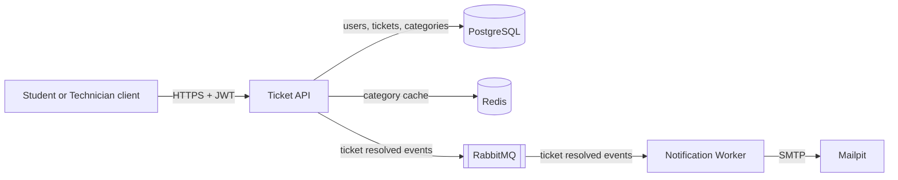
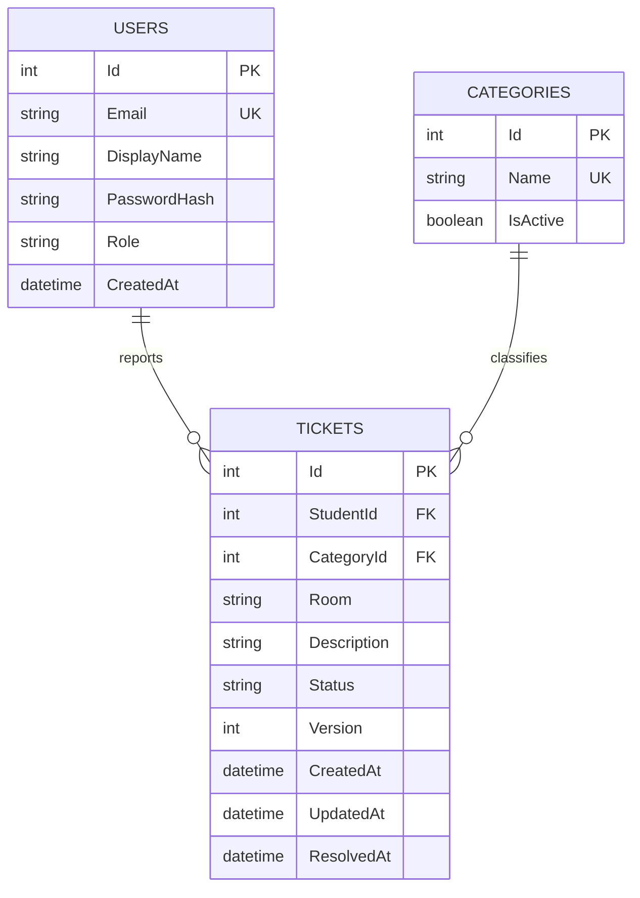

# Design

**University Helpdesk API** — *Sistem për raportimin e problemeve teknike në universitet*

This document describes the planned architecture. The requirements are in
[`requirements.md`](requirements.md) and the HTTP contract is in
[`api-contract.md`](api-contract.md).

## Services

The system has two separately deployable components:

- **Ticket API** — the HTTP API used by students and technicians. It stores
  users, categories, and tickets in PostgreSQL and caches the category list in
  Redis.
- **Notification Worker** — a background service that receives
  ticket-resolved events from RabbitMQ and sends confirmation emails. During
  local development, emails go to Mailpit, a test SMTP server with a web inbox.



The API and the worker share no in-process state. They communicate only through
RabbitMQ, so either one can be restarted, scaled, or deployed without the other.

## Data model



| Table        | Notes                                                                                                                                                        |
| ------------ | ------------------------------------------------------------------------------------------------------------------------------------------------------------ |
| `Users`      | `Email` is unique and is the address used for resolution notifications. `Role` is `Student` or `Technician`.                                                 |
| `Categories` | `Name` is unique. Inactive categories stay in the table so existing tickets keep their category, but they are not listed or accepted for new tickets.         |
| `Tickets`    | `StudentId` references `Users.Id` and must belong to a `Student`. `CategoryId` references `Categories.Id`. `Status` is `Open`, `InProgress`, or `Resolved`. `ResolvedAt` is null until the ticket is resolved. `Version` supports concurrency checks. |

A student has zero or more tickets; each ticket has exactly one student owner
and one category. Deleting a user or category that has tickets is not
supported.

### Pending notifications

The `PendingNotifications` table acts as an outbox between the database and
RabbitMQ:

| Column           | Purpose                                                        |
| ---------------- | -------------------------------------------------------------- |
| `Id`             | Primary key. A stable event ID (UUID) generated by the API.    |
| `TicketId`       | The resolved ticket (foreign key to `Tickets.Id`).             |
| `RecipientEmail` | Copy of the student's email at the time of resolution.         |
| `EventType`      | `TicketResolved`.                                              |
| `Payload`        | JSON with the details needed to write the email.              |
| `CreatedAt`      | When the row was written.                                      |
| `PublishedAt`    | Null until the event has been published to RabbitMQ.           |
| `Attempts`       | Number of publish attempts, used for retry and alerting.       |

`(TicketId, EventType)` is unique, so a ticket can never have two resolution
events.

## Layers

The Ticket API is split into three layers. Each layer only calls the one below
it.

| Layer          | Responsibility                                                                                                                                                                         |
| -------------- | -------------------------------------------------------------------------------------------------------------------------------------------------------------------------------------- |
| HTTP           | Routing, authentication, reading the user ID and role from the JWT, request validation, and mapping results and errors to the status codes in the API contract. No business rules. |
| Business logic | Ownership and role rules, the status workflow, and deciding when a notification is needed. Independent of HTTP and of the database technology, so it can be unit tested.          |
| Persistence    | PostgreSQL access, transactions, concurrency checks, the Redis category cache, and the outbox. Returns domain objects, not HTTP responses.                                          |

## Ticket workflow and permissions

```text
Open → InProgress → Resolved
```

- A new ticket is always `Open`.
- Only a `Technician` changes status, and only one step forward at a time.
  `Resolved` is final.
- A `Student` can edit (room, category, description) or delete **their own**
  ticket only while it is `Open`. Once work starts, the ticket is locked for the
  student.
- A `Student` sees only their own tickets. Another student's ticket is treated
  as not found, so its existence is not revealed.
- A `Technician` sees all tickets but cannot create, edit, or delete them.
- The server controls the owner (`StudentId`), `Status`, `Version`, and all
  timestamps. Clients cannot set them directly.

## Consistency and resilience

These rules guide the later implementation.

**Concurrent edits and status changes.** Every ticket has a `Version` that the
server increments on each change. Clients send the version they last saw with
every edit or status change. The update is applied only if both the version
and the expected current status still match in the database; otherwise the
request fails with `409 Conflict` and nothing is changed. This prevents, for
example, a student editing a ticket at the same moment a technician moves it to
`InProgress`, or two technicians advancing the same ticket twice.

**Resolution and notification together.** When a ticket moves to `Resolved`,
the status change and a new `PendingNotifications` row are written in the same
database transaction. Either both are saved or neither is. A background
publisher then sends unpublished rows to RabbitMQ and marks them as published.
If RabbitMQ is down, rows wait and are retried, so no notification is lost and
the technician's request is not affected. A row is marked published only after
the broker confirms the message, so delivery is at least once: a crash after the
confirmation but before the database commit publishes the event again. The
worker must tolerate receiving the same event more than once; every message
carries the event ID as its message ID.

**Category cache fallback.** `GET /categories` first reads the category list
from Redis. On a cache miss, the API reads from PostgreSQL and stores the result
in Redis with a short expiry (planned: 5 minutes). If Redis is unreachable, the
API logs a warning and serves the list from PostgreSQL, so the endpoint keeps
working without the cache.

## Deployment and operations

| Area               | Plan                                                                                                                                                       |
| ------------------ | ---------------------------------------------------------------------------------------------------------------------------------------------------------- |
| Local development  | Docker Compose starts the Ticket API, Notification Worker, PostgreSQL, Redis, RabbitMQ, and Mailpit with one command.                                      |
| Kubernetes         | The Ticket API runs as a Deployment with two replicas behind a Service, which load-balances requests between them. The worker runs as its own Deployment. |
| CI/CD              | GitHub Actions builds the solution and runs the tests on every push and pull request, then verifies that the containers start and pass health checks.     |
| Monitoring         | Structured logs with a trace ID per request, liveness and readiness health check endpoints used by Kubernetes probes, and request count and latency metrics. |

The exact health check and metrics paths will be added to the API contract when
they are implemented.
