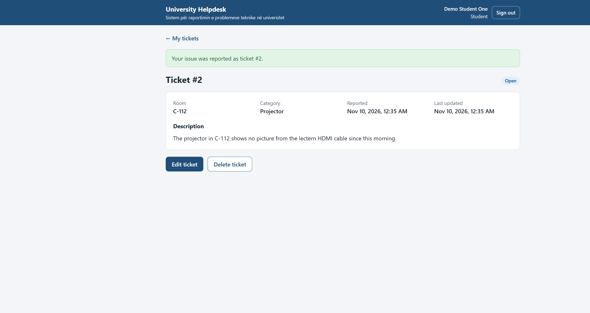
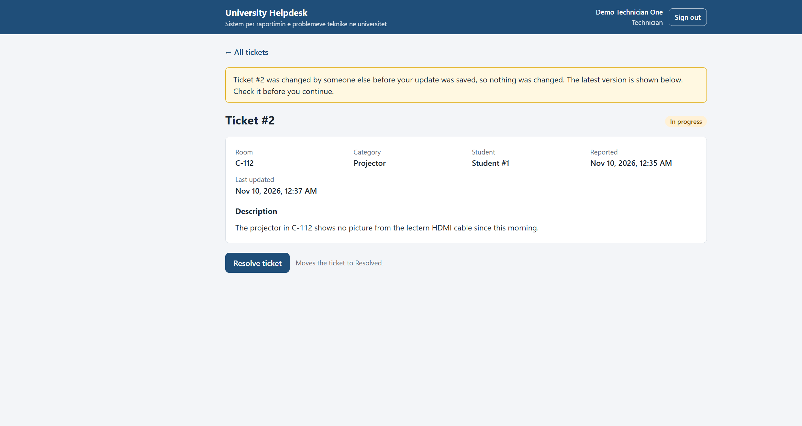
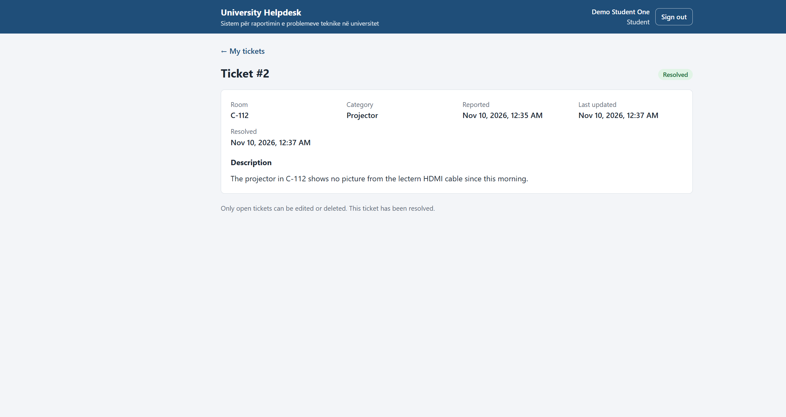
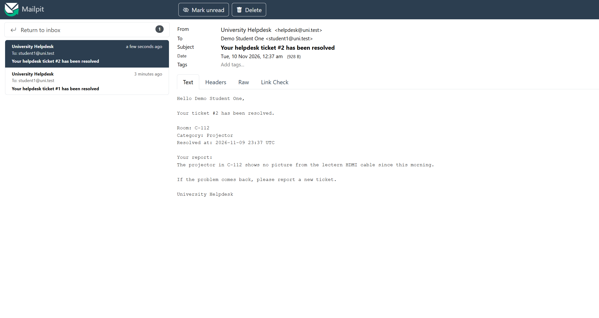

<!-- Slides in Marp format: each "---" starts a new slide. The Marp extension
for VS Code or `npx @marp-team/marp-cli docs/presentation.md --pdf
--allow-local-files` exports them (the flag lets them embed the screenshots). Every number comes from docs/verification-results.md,
docs/benchmark-results.md, docs/test-cases.md, or docs/demo-runbook.md. -->

# University Helpdesk

**Sistem për raportimin e problemeve teknike në universitet**

A Ticket API, a Notification Worker, and a React web app

Ueb Shërbimet dhe Ueb API-të, project defense

_Group members: to be completed by the team_

---

## The problem

- Students find broken classroom technology: projectors, computers, network,
  audio, smart boards.
- **University Helpdesk:** students report problems as tickets, technicians
  move them through `Open → InProgress → Resolved`, and the student gets an
  email when the ticket is resolved.

| Role | Can do |
| ---- | ------ |
| Student | Report problems; view, edit, and delete their own tickets while `Open` |
| Technician | View every ticket; move a ticket one status forward |

---

## Architecture

```text
 Browser: React app          Swagger / Postman
        │ /api/... + JWT           │ HTTP + JWT
        ▼                          ▼
   nginx gateway (serves the app) ──► Ticket API ×2 ──► PostgreSQL (data + outbox)
                                          │      └────► Redis (category cache)
                                          │ TicketResolved event
                                          ▼
                                      RabbitMQ ──► Notification Worker ×1 ──► SMTP (Mailpit)
```

- **React app:** React 19, React Router, TypeScript, built by Vite inside
  the gateway image; student and technician pages.
- **Ticket API:** ASP.NET Core 10, controllers → services → EF Core.
- **Notification Worker:** .NET 10 worker service, no HTTP and no database.
- Docker Compose runs everything, including the app. Kubernetes (local kind
  cluster) runs the backend only: API, worker, PostgreSQL, RabbitMQ, Redis,
  and Mailpit.

---

## Why two services, and why RabbitMQ

**Separate API and worker**

- Email is slow and depends on an outside server; ticket requests must stay
  fast. A slow or failed mail server never blocks or fails a request.
- A crash in one service does not stop the other.
- They scale differently: 2 API replicas, 1 worker.
- The API itself stays one layered service: users, categories, and tickets
  change together in the same transactions.

**RabbitMQ**

- Durable queue: the event waits while the worker is stopped.
- Publisher confirms and late acknowledgements: no side loses an event.
- Failed deliveries go to a failed queue for inspection, not into the void.

---

## Why PostgreSQL

The data is relational, and the rules are enforced by the database itself:

- Foreign keys: ticket → student, ticket → category, event → ticket.
- Unique: user email, category name, one resolution event per ticket.
- Checks: valid role and status, `ResolvedAt` set exactly when `Resolved`.
- **Transactional outbox:** the status change and its event are saved in one
  transaction, then published.
- Conditional `UPDATE … WHERE Version = @v`: no lost updates (`409`).
- `FOR UPDATE SKIP LOCKED`: the two API replicas never publish the same event.

---

## Security

- Sign-in returns a signed JWT (1 hour) with the user's ID and role;
  passwords are stored as hashes.
- Every endpoint except login needs the token. Anonymous by design: login,
  `/health/*`, Swagger (Development only), and `/metrics`, which is blocked at
  the gateway.
- Roles are checked on the server: a student changing a status gets `403`;
  another student's ticket is `404`.
- Server-side validation (`400` with problem details); errors never leak
  exception details; queries are parameterized by EF Core.
- Secrets live in `.env`, Kubernetes Secrets, or user secrets, never in Git.
- The app keeps the token in the tab's session storage; the gateway sends a
  Content Security Policy that allows scripts and requests only to itself.

**HTTPS.** Verified locally with `dotnet run --launch-profile https`: HTTP is
redirected to HTTPS (`307`), using the .NET development certificate, which is
**not trusted on the demo laptop**. Compose and kind use plain HTTP on the
local machine only. TLS for a published deployment is designed, **not
implemented or tested**.

---

## Live demo: the web app

_React app on the Docker Compose system, student and technician in separate
windows. Steps in `docs/demo-runbook.md`._

1. Student signs in and reports: room `C-112`, Projector → **Open**.
2. **Access check:** the student opens a technician page → "Not allowed";
   the API would answer `403`.
3. Technician: **Start work** → In progress. A second technician tab with
   the old version → `409`, a warning, and the page reloads.
4. Technician: **Resolve ticket** → Resolved, version 3.
5. Student refreshes → Resolved, no edit or delete.
6. Mailpit: "Your helpdesk ticket #2 has been resolved"; PostgreSQL: the
   ticket row and its outbox row with `PublishedAt`.

Run on 10 Nov through the gateway: every step as expected; the email arrived
0.3 s after resolving.

---

## Live demo: the screens

 
 

**Backup:** the same story in Swagger (runbook, "The demo in Swagger"),
rehearsed twice on 9 Nov; the email arrived 0.6 to 0.9 s after resolving.

---

## Tests

| Suite | Result |
| ----- | ------ |
| API tests, including 24 HTTP integration tests on real PostgreSQL | **110 / 110** passed (9 Nov) |
| Notification Worker tests | **14 / 14** passed (9 Nov) |
| Recovery checks: worker, SMTP, RabbitMQ, and Redis outages | **5 / 5** passed (8 Nov) |
| Postman collection through the gateway (Newman) | **27 / 27** passed (8 Nov) |
| Web app in a browser through the gateway | **7 / 7** browser checks passed (10 Nov) |

- 43 documented test cases with input, expected result, actual result, and
  evidence (`docs/test-cases.md`).
- Covered: CRUD, invalid input (`400`), roles (`401`/`403`), ownership
  (`404`), the status workflow, concurrent edits (one `200`, seven `409`), and
  a `500` without details.
- Not covered by a test: duplicate emails after a worker crash (possible by
  design), SQL injection-style input. The web app has no automated UI tests;
  its checks were run in a browser.

---

## CI and deployment

**GitHub Actions** on every push to `main`, every pull request, and manually:

1. Build and run the ordinary test suite.
2. Deploy the backend to a fresh kind cluster and run a smoke test: student
   reports, technician resolves, email in Mailpit.
3. Build the gateway image: `npm ci` from the lockfile, lint, and build the
   app, then check the nginx configuration.

**17 of 17 runs succeeded** (9 and 10 Nov), each in about 2 to 3 minutes;
the latest checked is run 42722426707 on `ef61cb1`. Integration and recovery
tests need real services and run locally, not in CI.

**Deployment checks**

- Compose (8 Nov): 2 API replicas behind nginx both served requests; data
  survived `down` and `up`. (10 Nov): the gateway served the app, direct
  links, the API under `/api`, and the full browser flow.
- Kubernetes (8 Nov, backend only): ordered start-up through a `db-init` Job; 60 requests split
  21 / 39 across the two pods; data survived replacing both API pods and
  re-creating the PostgreSQL pod.

---

## Performance

Target (NFR-P1): `GET /tickets` p95 under **300 ms** with 20 concurrent users
and 1,000 tickets, on the Compose system.

| | Result |
| - | ------ |
| `GET /tickets` p95, 7 runs | **76.5 to 133.0 ms**, 0 failures |
| `POST /tickets` p95, 3 runs | 60.6 to 118.8 ms |

- **Finding:** logins looked slow (2.7 s median). The cause was the client:
  `localhost` tried IPv6 first and each new connection waited about 2 s.
  With `127.0.0.1`: 0.55 to 0.65 s.
- **Honest result:** the Redis cache works (counters show every hit and miss),
  but this workload did not show it to be faster.
- One 4-core laptop; results vary about 30% between runs.

---

## Limitations and next steps

- Development configuration with demo accounts; HTTPS only verified locally
  with an untrusted development certificate.
- Integration and recovery tests are not run in CI; the web app has no
  automated UI tests, and CI only checks that it lints and builds.
- The Kubernetes manifests deploy the backend only; the web app runs with
  Docker Compose.
- Compose does not restart PostgreSQL, RabbitMQ, Redis, and Mailpit after the
  host restarts (fix found, not applied yet).
- Not implemented: API versioning (`/v1`), multi-factor authentication, a
  web application firewall, a Prometheus server.
- Next: automated browser tests for the web app, and the app in the
  Kubernetes deployment.

---

## Individual contributions

_Each member presents their own confirmed contribution. To be completed by
the team, matching `docs/sources-and-contributions.md`. Git records commits
from two GitHub accounts, `rinesaavdiu` and `domenikka`; a commit's author
does not show who wrote the change._

| Member | Contribution | Evidence |
| ------ | ------------ | -------- |
| _Name_ | _To be completed_ | _To be completed_ |
| _Name_ | _To be completed_ | _To be completed_ |

---

## Sources and AI use

- Libraries, npm packages, images, and references with versions and
  licenses: `docs/sources-and-contributions.md`. All are open source (MIT,
  Apache-2.0, PostgreSQL, and others listed there).
- **AI use:** our team organized the project into milestones, directed
  changes as issues came up, and managed the Git history. We used ChatGPT
  throughout the project to help plan the work, break down the assignment
  requirements, and troubleshoot. We also used AI coding assistance to
  generate and revise code, tests, configuration, and documentation, and to
  run verification checks, including the React frontend and the browser
  checks. Individual contributions are listed separately.

---

# Questions

Repository: `github.com/rinesaavdiu/University_Helpdesk`

Documentation: `README.md` and `docs/`
